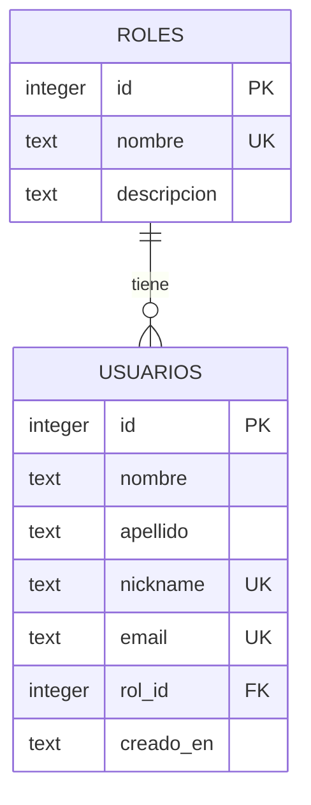

# Sprint 2 — ABM de usuarios

Aplicación PHP con listado, búsqueda, alta, edición y eliminación de usuarios. Interfaz en español y adaptable a celulares. El portal estático existente se conserva; este módulo se ejecuta por separado.

## Ejecutar

Requisitos: PHP 8.1 o superior con PDO, pdo_mysql y mbstring. MySQL 8.0.16+ o MariaDB 10.4+ (incluido en XAMPP). No necesita Composer.

Desde la raíz del repositorio:

```powershell
php abm/database/install.php
php -S localhost:8080 -t abm/public
```

Abrir http://localhost:8080. Iniciar MySQL en XAMPP antes de instalar. La instalación crea la base `peluqueria_abm`, las tablas y tres roles; puede repetirse sin borrar registros. La configuración local predeterminada es `127.0.0.1:3306`, usuario `root`, contraseña vacía. Para cambiarla, copiar `config/database.example.php` a `config/database.php` (ignorado por Git), o definir `ABM_DB_HOST`, `ABM_DB_PORT`, `ABM_DB_NAME`, `ABM_DB_USER`, `ABM_DB_PASSWORD`. No se migran automáticamente datos de una base SQLite previa.

El servidor de desarrollo debe usar **abm/public** como raíz, para que la base de datos y el código interno no queden expuestos. El ABM requiere una sesión de administrador. Los roles del ABM describen usuarios y no conceden acceso al panel.

## Modelado de entidades



Cada usuario debe tener exactamente un rol. Un rol puede tener cero o muchos usuarios. La clave foránea impide asignar roles inexistentes y eliminar roles que tengan usuarios. Nickname y email son únicos sin distinguir mayúsculas y minúsculas según la colación utf8mb4_unicode_ci. El catálogo de roles se consulta desde la interfaz; el ABM solicitado corresponde a usuarios.

## Implementación

- `database/schema.sql`: tablas, restricciones, índice y roles iniciales.
- `src/bootstrap.php`: conexión PDO, consultas preparadas, validación y operaciones sobre usuarios.
- `public/index.php`: controlador HTTP y vistas renderizadas en PHP; no requiere JavaScript.
- `public/styles.css`: interfaz responsive.
- `tests/run.php`: pruebas funcionales en una base MySQL temporal independiente, eliminada al finalizar (requiere permisos CREATE/DROP DATABASE).

Las escrituras usan POST y token CSRF. El borrado tiene pantalla de confirmación. Los datos se escapan al mostrar HTML. Se conservan los valores del formulario ante errores y se usa redirección luego de guardar para evitar reenvíos al recargar.

## Validación

```powershell
php abm/tests/run.php
```

Prueba manual: crear un usuario, buscarlo, editarlo y cambiar su rol; intentar repetir email y nickname; cancelar la eliminación; confirmar la eliminación. Verificar que los datos sobrevivan al reinicio del servidor.

## Calendario de reservas

El portal se puede probar con `php -S localhost:8081` y abrir `/pages/reservas.html`. El calendario respeta días de apertura, descarta fechas y horarios pasados, reinicia el horario al cambiar servicio o fecha y vuelve a validar antes de guardar. Las reservas siguen usando localStorage del navegador: esta adaptación a MySQL corresponde al ABM de usuarios y roles; las reservas no están sincronizadas entre dispositivos.

Pruebas del calendario: `node --test tests/calendar.test.cjs`.

## Login de Aura Studio

Ejecutar nuevamente `php abm/database/install.php` para agregar la tabla de acceso sin borrar los usuarios. Abrir `http://localhost:8080/login.php`: la primera vez permite crear una cuenta de administrador únicamente desde localhost. Elegir email y contraseña propios; no hay credenciales predeterminadas. Después del alta, esa pantalla se convierte en login.

El administrador se guarda en `administradores`, separado de los usuarios gestionados por el ABM. Las contraseñas se guardan con password_hash y se verifican con password_verify. El acceso usa sesiones, CSRF, regeneración del identificador, vencimiento por inactividad (30 minutos) y bloqueo de 5 minutos tras 5 errores. Cerrar sesión usa POST e invalida la sesión.

El botón superior del portal y de reservas apunta a `abm/public/login.php` relativo al proyecto; para el servidor dedicado del ABM usar `/login.php`. En un despliegue público configurar HTTPS y servir únicamente los directorios públicos.
